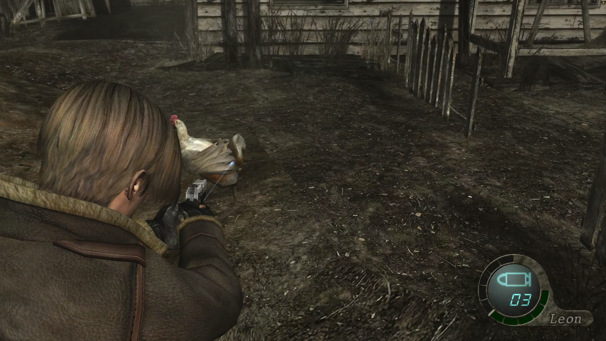
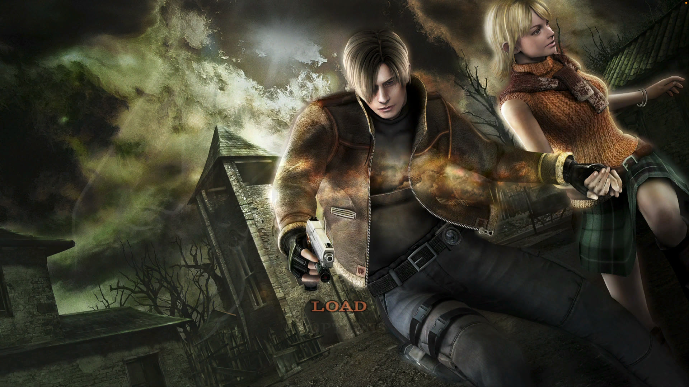
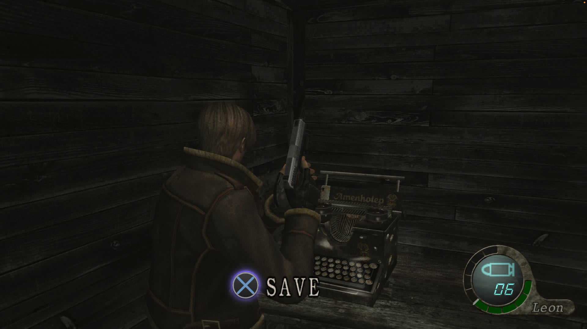
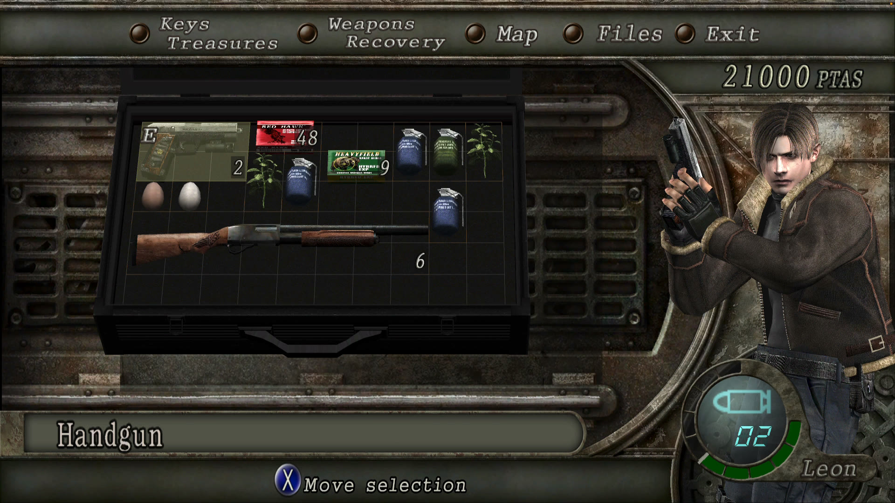
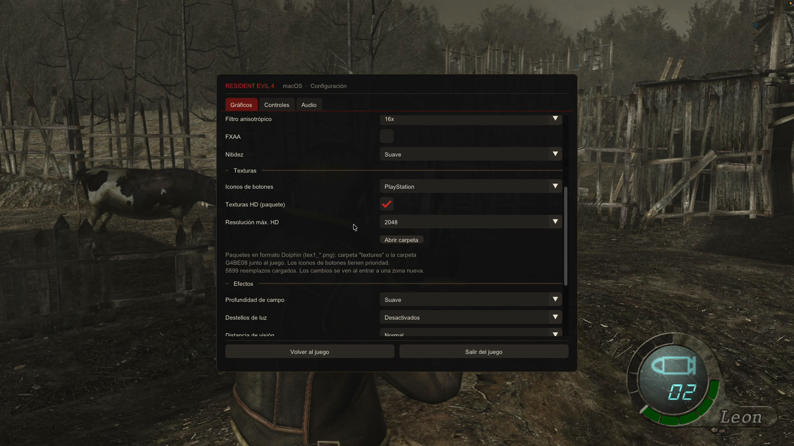

<div align="center">

# RE4 Mac

**Resident Evil 4 (GameCube) on Apple Silicon.**
A native Mac front end for the community decompilation, with 60 fps output, controller support, an in-game settings menu and HD texture pack support.


-5586A4)


</div>

> Unofficial, non-commercial fan project. **No game data included**: you need your own copy of the game.
> Not affiliated with Capcom, Nintendo or CRI Middleware. See [Legal](#legal).

<p align="center">
  
</p>

## Screenshots

| | |
|:--:|:--:|
| <br>Title screen | <br>PlayStation button icons |
| <br>HD texture pack (RE4 HD Project) | <br>In-game settings menu |

> The settings menu is currently in Spanish. Translations are welcome.

## Highlights

- 🍎 **Runs on Apple Silicon.** Developed and tested on a Mac with an **M1 Pro and 16 GB of RAM**, where it runs very well. It should run on any Apple Silicon Mac (M1 and later), though I have only tested that one machine.
- 🎞️ **60 fps output.** The game logic runs at its original 30 Hz and the front end interpolates the in-between frames. Press `H` to toggle it.
- 🖼️ **Sharper picture.** Internal resolution scale (default 3x), anisotropic filtering, and a "native" picture format that fits your screen.
- 🎮 **Controllers and keyboard + mouse.** PlayStation pads work (with a PlayStation button-icon pack included), plus mouse aiming and control presets (HD classic, modern, GameCube).
- 🧰 **In-game settings menu** for graphics, controls and audio. Open it with `Esc`, or with the PS / Share button on a PlayStation pad.
- 🎨 **HD texture packs.** Loads Dolphin-style texture packs, for example the [RE4 HD Project](https://www.re4hd.com/), straight from a folder.
- 📦 **Packaged as a normal Mac app.** A script builds `Resident Evil 4.app`, which asks once for your game data folder and remembers it.

## How it works

The game is split into two programs that talk through shared memory:

```
 ┌───────────────────────────── Resident Evil 4.app ─────────────────────────────┐
 │                                                                               │
 │   re4_mac  (arm64, native)                    re4_coreproc  (x86_64, Rosetta) │
 │   ┌─────────────────────────┐   shared mem   ┌────────────────────────────┐   │
 │   │ window · OpenGL renderer│ ◄────────────► │ the decompiled game code   │   │
 │   │ audio · input · menu    │   (IPC)        │ (logic, scripting, assets) │   │
 │   └─────────────────────────┘                └────────────────────────────┘   │
 └───────────────────────────────────────────────────────────────────────────────┘
```

It is a **hybrid, not 100% native**. The front end is native arm64, but the game core runs as x86_64 under **Rosetta 2**.

**Why?** The game expects its RAM at the fixed address `0x80000000` and stores pointers as 32-bit values. macOS reserves the first 4 GB of every arm64 process, so that address cannot be mapped. Under Rosetta it can.

The game logic is light (about 1 ms per frame in my tests), so running it under Rosetta costs very little. The heavy part, drawing, is native.

> ⚠️ **Rosetta 2 is required**, and Apple has said it will phase it out in future macOS versions. A fully arm64 core is the main roadmap item; see [Roadmap](#roadmap).

## What you need

| | |
|---|---|
| **Hardware** | An Apple Silicon Mac (M1 or later). Tested on M1 Pro, 16 GB. |
| **Rosetta 2** | `softwareupdate --install-rosetta --agree-to-license` |
| **Game data** | The extracted file systems of **your own** two discs (see below) |
| **To build** | Homebrew packages `cmake ninja lld sdl3`, [Dear ImGui](https://github.com/ocornut/imgui) v1.91.9, and a **case-sensitive** volume for the source tree |

### Your game data

Extract the file systems of your own two discs into one folder:

```
disc-data/
  disc0/   sys/ and files/ of disc 1
  disc1/   sys/ and files/ of disc 2
```

Tested with the discs of the debug build (`G4BE08`). The retail releases (EU, US, JP) are supported by the upstream core but I have not tested them on macOS.

The app asks for the folder the first time and remembers it. You can also set `RE4_DATA=/path/to/disc-data`.

## Build

The repository must live on a **case-sensitive** volume, because it contains both `src/Tools` and `src/tools`. A case-sensitive APFS disk image works:

```sh
hdiutil create -size 8g -type SPARSE -fs "Case-sensitive APFS" -volname RE4CS re4cs
hdiutil attach re4cs.sparseimage          # mounts at /Volumes/RE4CS
```

Then, from the repository:

```sh
# 1. The game core (x86_64). Use Release: a debug build is far too slow.
cmake -S port/whole -B build-mac-x64 -G Ninja \
  -DCMAKE_OSX_ARCHITECTURES=x86_64 -DCMAKE_BUILD_TYPE=Release
ninja -C build-mac-x64 -k 0      # a few unrelated targets fail; -k 0 keeps going

# 2. The native front end (arm64)
IMGUI=/path/to/imgui sh port/whole/host/macos/build_native.sh build-mac-x64

# 3. Optional: package "Resident Evil 4.app" (no game data inside)
sh port/whole/host/macos/package_app.sh build-mac-x64 .
```

To run without packaging:

```sh
build-mac-x64/re4_mac build-mac-x64/libre4_main.dylib build-mac-x64/modules /path/to/disc-data
```

## Controls

| Action | Keyboard |
|---|---|
| Move | `W` `A` `S` `D` |
| A / B / X / Y | `J` / `K` / `U` / `I` |
| Start | `Enter` |
| D-pad | Arrow keys |
| Aim | Mouse |
| Settings menu | `Esc` (on a PlayStation pad: PS or Share) |
| Fullscreen | `F` |
| Toggle 60 fps interpolation | `H` |

Controller layouts (HD classic, modern, GameCube) and mouse aiming are chosen in the settings menu.

## Texture packs

The app looks for Dolphin-style texture packs in these places:

1. The bundled PlayStation button icons (`textures/ps-buttons`).
2. A folder named `G4BE08` or `textures` next to the app, for example the HD Project.
3. `~/Library/Application Support/RE4 Mac/textures`

Set `RE4_TEXTURE_DUMP=1` to dump the textures the game loads, which is how you make your own packs.

## Tweaks and files

| Setting | How |
|---|---|
| Internal resolution scale | Settings menu, or `RE4_SCALE=2` |
| Windowed mode | `RE4_WINDOWED=1` |
| Disable 60 fps interpolation | `RE4_60FPS=0` |
| Settings file | `~/Library/Application Support/RE4 Mac/settings.ini` |
| Log of the last run | `~/Library/Application Support/RE4 Mac/last-run.log` |

Please attach `last-run.log` when you report a bug.

## Known limitations

- **Needs Rosetta 2** (see above).
- **Game logic stays at 30 Hz.** 60 fps is interpolated, not a native 60 Hz game.
- Tested on **one machine** (M1 Pro, 16 GB). Reports from other Apple Silicon Macs are very welcome.
- Not every room has been played through on macOS.
- Some leftover build targets (for example `card_probe` and the Linux host) don't build on macOS. They are not needed to play.

## Roadmap

- [ ] A fully **arm64 game core**, to drop Rosetta. Ideas: a 4 GB-aligned memory arena so the existing 32-bit pointer scheme keeps working, or a 32-bit sandbox.
- [ ] Test on more Macs and macOS versions.
- [ ] Pre-built releases.
- [ ] A Metal renderer (the OpenGL renderer is fast enough for now).

Contributions and ideas are welcome. Open an issue or a pull request.

## Credits

This port only adds a macOS front end. The hard work is theirs:

- **[adonis-singh](https://github.com/adonis-singh/re4)**: the complete decompilation of Resident Evil 4 (GameCube).
- **[Andiweli](https://github.com/Andiweli/CubeEvil4-Android)**: the Android port this one is built on (platform layer, GX renderer, core API).
- **Capcom**: Resident Evil 4, and all of its code, art, music and design.
- **Nintendo, CRI Middleware**: the SDK and middleware the game is built on.
- The **[RE4 HD Project](https://www.re4hd.com/)** team, for the texture packs this port can load.

The original Android README is kept in [`docs/android-upstream-README.md`](docs/android-upstream-README.md).

## Legal

This is an unofficial, non-commercial fan project. It is not affiliated with, endorsed by or sponsored by Capcom, Nintendo or CRI Middleware, and it contains **no game data**. If you do not own the game, please buy the *Resident Evil 4* remake or an official re-release.

The build scripts, tools, configuration, documentation and the code written for this macOS port are released under CC0 1.0. This does **not** cover the reconstructed game, SDK and middleware source in `src/` and `include/`, which remains the property of Capcom, Nintendo and CRI Middleware and is published for research and preservation only.
